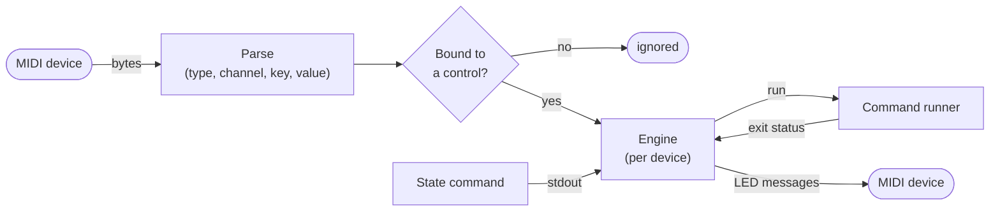

# How controls behave

This page explains what happens between a MIDI message arriving and a command
running, for each kind of control. The config fields are in the
[config reference](config.md).

## The pipeline

- Each device has its own thread and engine, so several devices run side by side.
- The MIDI callback only parses the message and queues it. Clock, active
  sensing and SysEx messages from the device are ignored.
- A message is matched on its type (`note` or `cc`), number and channel. Note
  on with velocity 0 counts as note off, as the MIDI spec says.
- Commands run in the background. The engine hears back when they finish and
  whether they succeeded, which drives LED feedback and switch state.

## Trigger

A trigger runs its command on every **press**:

- for `note` controls, a press is a note on, and the note off is ignored;
- for `cc` controls, a press is a value above 0 after a 0 (most buttons send
  127 then 0). Buttons that never send 0 work too: a repeat of the same value
  counts as a new press.

Pads set to **toggle** mode on the controller send "on" on one press and "off"
on the next, so midiboard only sees every other press. Set the pads you bind
to **gate** (momentary) mode; on a BeatStep, `take_over_pads` or
`midiboard beatstep setup --gate-pads` does it for you.

Presses closer together than `debounce_ms` (default 50 ms) are ignored, to
filter contact bounce. If the command is still running when you press again,
the press is queued (up to 4) and runs as soon as the previous one finishes, so
no press is lost and commands never overlap.

## Switch

A switch toggles between on and off on every press, using the same press
detection and debounce as triggers.

- The first press goes to the opposite of the starting state: `initial_state`,
  or the state reported by the `state` command.
- **The state only changes when the command succeeds.** If the `on` command
  fails, the switch stays off, its LED shows off (after a short flash of the
  `error` color, if configured), and the next press tries `on` again.
- Pressing while a command is still running queues one toggle. Pressing twice
  while it runs cancels out.
- With a `state` source, the switch also follows changes made outside
  midiboard, such as muting from the desktop. See
  [feedback](feedback.md#external-state-sync).

## Encoder

An encoder turns knob and fader movement into a value between `map_min` and
`map_max`, and runs its command with that value. The short version:

- **Every message counts.** Each one updates the value immediately; nothing is
  dropped or windowed.
- **Only running the command is rate limited.** The first movement after a
  pause runs right away. While you keep turning, the command runs at most once
  every `rate_limit_ms`, always with the newest value. When you stop, the final
  value always runs, so the result matches where the knob is.
- **Commands never pile up.** If a command is slow, the newest value waits and
  runs as soon as it finishes; values in between are skipped.
- A run is skipped when it would produce the same `{value}` as the previous run.

Encoders support absolute controls (0-127 position) and endless relative
encoders, with acceleration and jitter filtering. All of that is in
[encoders](encoders.md).
